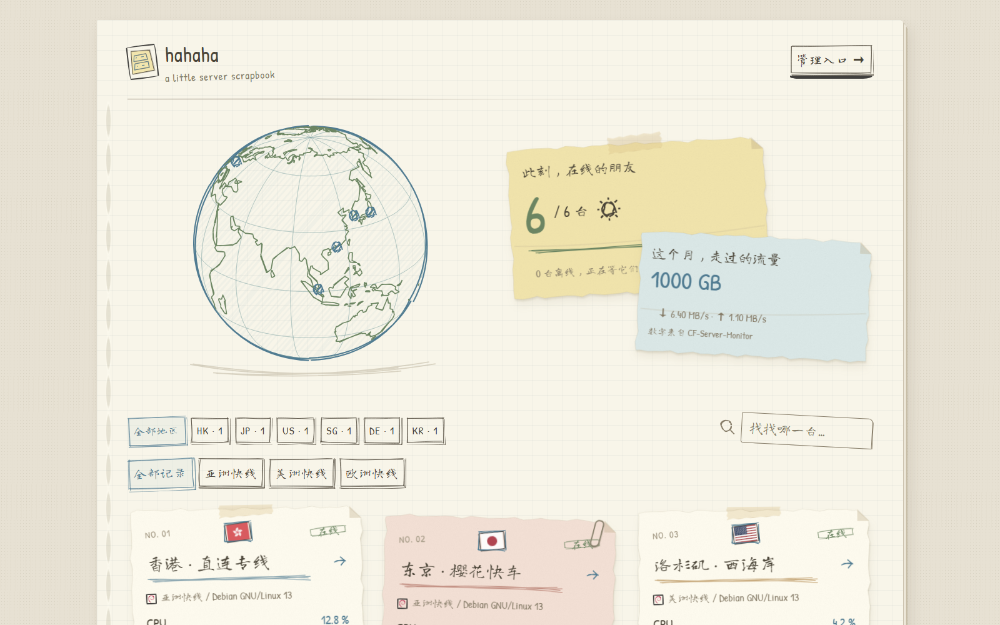

# hahaha · CF-Server-Monitor

纸张、手写文字、手绘曲线与缓缓转动的地球。基于 **Vue 3 + TypeScript + Vite + Vue Router**，适配 CF-Server-Monitor 的独立主题，版本 **0.1.0**。



预览使用演示节点。此项目面向 CF-Server-Monitor；原 Monitor 主题及其仓库独立维护。

## 功能

- 首页国家/分组筛选、搜索、手绘纸张卡片；地球节点定位对应卡片。
- 资源与延迟详情、GPU、磁盘 IO、最多 7 天历史；匿名用户最多 24 小时。
- 多后端同屏、字符串节点 ID、按来源隔离请求与缓存。
- 后台控制明暗外观、中英文、标题及显示开关；公告和墨水色读取 `theme_options`。
- 同源 Cookie/JWT、跨源 WebSocket token、按后端缓存 Turnstile 凭证。
- 实时数据仅通过 WebSocket；首页每秒合并更新，隐藏页面关闭连接，无 REST 定时轮询、无悬停历史预取。

## 本地开发

需要 Node.js 22.12+ 或 24+、npm。

```powershell
npm ci
$env:CF_BACKEND = 'http://127.0.0.1:8788'
npm run dev
```

`CF_BACKEND` 仅用于本地代理。后端需自行启动，建议使用隔离的官方 Wrangler + D1 环境，不要连接正在使用的生产站点。未设置时按当前 origin 请求 API。

```powershell
npm run build
```

## 在 Worker 内安装

`npm run build` 的产物严格只有：

```text
dist/
├── index.html
└── assets/
```

将这两项放到独立主题仓库的构建分支。CF 内置后台的主题地址使用 `https://github.com/ayingQAQ/cf-monitor-theme-hahaha/tree/dist`；安装由内置后台接管。**不使用旧 Monitor 的 theme.json 或 theme.tar.gz。**

国旗和系统图标从所属后端的 `/flags/`、`/os-icons/` 读取；字体、纸纹、脚本及许可证在主题的 `assets/` 中。Worker 的标题、背景、自定义 head 与脚本注入保持生效；管理入口始终为对应 Worker 的 `/admin#/admin`。

## GitHub Pages / 独立静态部署

```powershell
$env:API_BASE = 'https://<your-worker-domain>'
npm run build:github-page
```

`API_BASE` 支持英文逗号分隔的多个后端地址。运行时通过 HTML `meta[name=apiBase]` 读取，不请求 `config.json`。跨域部署须在**每个** Worker 配置 `CORS_ALLOWED_ORIGINS`，只填 origin，不含路径或结尾斜线。私有跨源部署需要该后端的 JWT；同源登录由内置后台写入 `localStorage.jwt_token`，静态页面须在自己的 origin 配置有效 JWT。多源使用 `jwt_token:<backend-origin>` 分别存放。旧的 `jwt_token` 仅用于当前同源后端；纯静态部署时仅用于第一个后端，不会发送到其余数据源。主题不实现登录或管理页面。

仓库附带 `.github/workflows/pages.yml`：推送 `main`/`master` 或手动触发后向 `dist` 分支追加提交，保留源码完整提交说明与构建历史，不强制推送。未设置 `API_BASE` 时生成 Worker 同源安装版本；配置后生成静态站点版本。配置仓库 Secrets：

| Secret | 用途 |
| --- | --- |
| `API_BASE` | 静态部署必填；Worker 同源安装不需要，多个后端以逗号分隔 |
| `TITLE` | 静态页面标题 |
| `BACKGROUND_IMAGE` | 静态背景图 |
| `CSP_API` | 额外 API origin，逗号分隔 |
| `CSP_STATIC` | 额外资源 origin，逗号分隔 |

在 Settings → Actions 允许 `contents: write`，在 Settings → Pages 选择 `dist` 分支根目录。首次部署和正式跨源发布需用独立 Worker 验证 CORS、JWT 与 WS，不要把 Worker 地址或凭证提交到源码。

## 后台配置

主题不新增设置入口。后台的 `theme_options` JSON：

```json
{"notice":"欢迎来到我的记录簿","ink":"blue"}
```

`notice` 是纯文本公告，默认空；`ink` 支持 `blue`、`green`、`orange`，默认 `blue`。系统级外观使用后台 `preferred_theme`、`default_language`、标题与背景设置；`sysConfig` 控制价格、到期、流量和三网小图。GPU/磁盘 IO 仅在有有效数据时显示。

## 数据与缓存

仅消费官方公开 API。配置和首页列表在页面生命周期内首次加载一次，路由切换复用；页面恢复、鉴权验证和用户手动重试属于明确例外。详情默认查询 10 分钟，资源/延迟切换复用响应，时间范围为 0.167 / 0.5 / 1 / 6 / 12 / 24 / 48 / 96 / 168 小时。

历史缓存上限 4 项 / 1 MiB / 60 秒，按后端、节点、时间范围与鉴权状态隔离。实时增量保留缺失字段、处理乱序样本；没有 503 REST 自动回退。WS 最多重试 8 次，退避封顶 30 秒；达到后台连接时限后，用户点击继续才恢复。内存/磁盘单位 MB，流量 B、网速 B/s，流量限额按官方实现的 GB 换算。

丢包 `0` 显示 `0%`，非零保留三位小数；`false`/缺失省略，`null` 显示超时。

## 许可与参考

[MIT](LICENSE)，第三方来源和完整授权见 [THIRD_PARTY.md](THIRD_PARTY.md) 与 [THIRD_PARTY_NOTICES.txt](THIRD_PARTY_NOTICES.txt)。

协议基线：[主题 API 文档](https://github.com/huilang-me/CF-Server-Monitor/blob/main/theme-develop.md)、[主题开发约束](https://github.com/huilang-me/CF-Server-Monitor/blob/main/theme-ai-prompt.md)。
